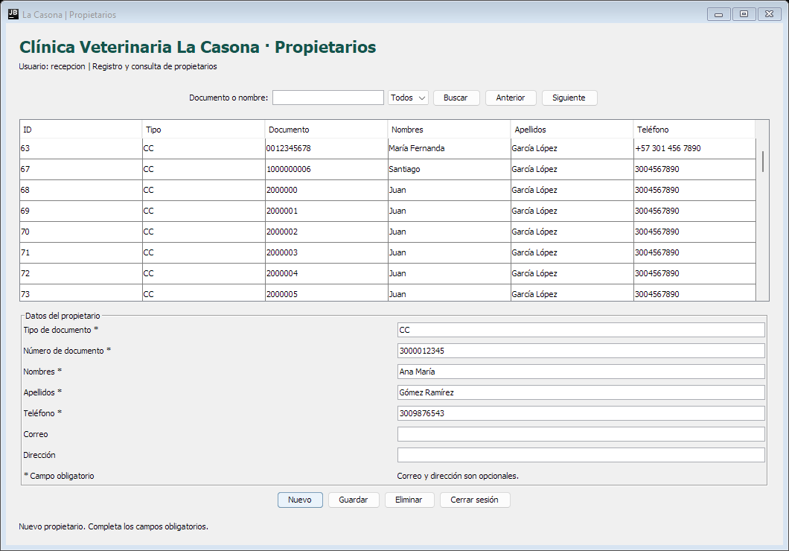

# Clínica Veterinaria La Casona · Módulo de propietarios

Evidencia **GA7-220501096-AA2-EV01: Codificación de módulos del software**, desarrollada por el aprendiz **James Alberto Torres Peláez**, del programa **Análisis y Desarrollo de Software** del SENA, ficha **3186594**.

En esta evidencia desarrollé un módulo para registrar, consultar, actualizar y eliminar propietarios de la Clínica Veterinaria La Casona. La aplicación funciona en escritorio con Java y Swing, y guarda la información en MySQL mediante JDBC.

## ¿Qué permite hacer?

- Ingresar con una cuenta del personal.
- Registrar tipo y número de documento, nombres, apellidos y teléfono.
- Agregar correo y dirección cuando se tengan estos datos.
- Buscar por documento, nombres o apellidos y filtrar por tipo de documento.
- Seleccionar un propietario para actualizar sus datos.
- Eliminar un propietario después de confirmar, siempre que no tenga mascotas ni facturas.
- Consultar los registros en páginas de 50 resultados.

Recepción puede gestionar los propietarios. Veterinaria y administración pueden consultarlos. Inventario no tiene acceso a esta consulta completa, porque sus consultas del paciente corresponden al proceso de entrega de medicamentos.

## Archivos principales

| Carpeta | Contenido |
| --- | --- |
| `src/main/java` | Código del módulo, separado por responsabilidades. |
| `src/test/java` | Pruebas de funcionamiento y del formulario. |
| `sql` | Estructura de la base, propietarios y cuentas de ingreso. |
| `config` | Ejemplos para configurar la conexión. |
| `lib` | MySQL Connector/J 9.7.0 y su información de licencia. |
| `scripts` | Archivos para compilar, ejecutar y realizar las pruebas. |
| `documentacion` | Instrucciones, revisión del alcance y explicación del código. |
| `evidencias` | Reportes de las pruebas y vistas del formulario. |

## Abrir con doble clic

1. Extraer todo el ZIP en una carpeta del equipo. No abrir el ejecutable desde dentro del ZIP.
2. Abrir **La Casona.exe** con doble clic y esperar la preparación inicial.
3. Ingresar con el usuario **recepcion** y la contraseña **Casona2026!**.

El lanzador busca Java y MySQL instalados. En el primer inicio prepara una base independiente,
crea las tablas y los registros del módulo, y guarda la conexión. No hace falta abrir Workbench
ni escribir comandos para este recorrido. Después abre la ventana de ingreso.

Se necesita Java 17 o superior y MySQL Server instalado en Windows. En el equipo de la evidencia
ambos programas ya están instalados. El ejecutable debe permanecer junto a las carpetas del
proyecto; no incluye un instalador de Java ni de MySQL.

La carpeta **datos** guarda la base local. Debe conservarse para no perder los registros.
La configuración y las contraseñas de conexión se crean en el equipo y no se suben al repositorio.
Si ya existe una conexión configurada, el lanzador la utiliza. Para utilizar una base que administra
otro servidor, ese servidor debe estar iniciado.

## Configuración manual

Se necesita un **JDK 17 o superior** y **MySQL 8.0.16 o superior**. El proyecto se comprobó en Windows con el JDK 25.0.2 incluido en Android Studio y MySQL 26.7.0. No es obligatorio usar Android Studio para ejecutarlo: se puede indicar otra carpeta de JDK.

El conector JDBC está incluido en `lib`, así que se puede compilar sin instalar Maven. También se incluye `pom.xml` para abrir el proyecto en un entorno compatible con Maven, como NetBeans.

1. Preparar la base con los scripts de `sql`, siguiendo [las instrucciones de ejecución](documentacion/INSTRUCCIONES.md).
2. Copiar `config/db.properties.example` como `config/db.properties` y completar la conexión.
3. Abrir PowerShell en la carpeta del proyecto y ejecutar:

```powershell
.\scripts\compilar.ps1 -RutaJdk "C:\Program Files\Android\Android Studio\jbr"
.\scripts\ejecutar.ps1 -RutaJdk "C:\Program Files\Android\Android Studio\jbr"
```

Para revisar el módulo, se puede ingresar con el usuario **recepcion** y la contraseña **Casona2026!**, después de importar `03_cuentas.sql`. Las otras cuentas son `veterinaria`, `administracion` e `inventario`, con la misma contraseña de ingreso. Cada cuenta guarda su contraseña transformada con una sal diferente.

## Pruebas realizadas

Se ejecutaron **24 pruebas de funcionamiento con JDBC y MySQL**, y **8 pruebas de los componentes del formulario Swing**. Las 32 pruebas quedaron aprobadas. Se comprobaron los cambios guardados en la base, los mensajes de validación, los duplicados y el rechazo de eliminaciones con registros relacionados.

Los reportes están en [pruebas de funcionamiento](evidencias/pruebas_integracion.csv) y [pruebas del formulario](evidencias/pruebas_interfaz.csv). El procedimiento está explicado en [cómo realizar las pruebas](documentacion/PRUEBAS.md).

Además, se comprobaron la preparación automática, la estructura, los registros, el ingreso,
la reapertura y el reinicio de la base del lanzador. Las seis comprobaciones quedaron aprobadas.
El reporte está en [pruebas del inicio automático](evidencias/pruebas_inicio_automatico.csv).



## Relación con el proyecto

El módulo desarrolla RF-04 y CU-05, conserva la regla de RF-25 y utiliza el modelo de datos existente. La revisión previa se encuentra en [revisión del alcance](documentacion/REVISION_DEL_ALCANCE.md).

Se mantuvieron las 19 tablas del modelo para conservar sus relaciones, pero esta evidencia desarrolla el formulario de propietarios y el ingreso necesario para usarlo. Los formularios de mascotas, citas, atención, inventario y facturación quedan para continuar el proyecto.

## Repositorio

El enlace se encuentra en `ENLACE_REPOSITORIO.txt`.

La carpeta `dist` incluye el módulo compilado. Después de configurar la base, `scripts/ejecutar.ps1` permite abrirlo sin volver a compilar. El código fuente también está incluido para revisarlo y realizar cambios.
